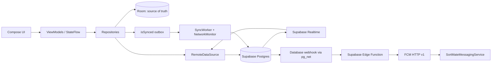

# SortMate Supabase Migration — Spec

## 1. Problem

The CS312 proposal selects Firestore and FCM. A database-triggered Firebase Cloud Functions sender would require Blaze, which the group cannot afford. The original implementation also lacked automatic **campus** geofencing, reconnect-triggered sync, and section 5A evidence.

## 2. Outcome

Replace the paid Firebase data path with a free-tier Supabase project while keeping FCM for push:

- Supabase Postgres + Row Level Security for household data.
- Supabase anonymous auth for account-less roommates.
- Supabase Realtime for live updates.
- Supabase Edge Function for database webhook → FCM HTTP v1.
- FCM remains the Android push transport.
- Home **and** campus geofences update presence through one pure resolver.
- Reconnect flushes the outbox immediately, with WorkManager as fallback.
- `docs/` is an Obsidian vault; `graphify` builds a code-only graph for token-efficient navigation.
- 5A metrics have a repeatable harness; physical measurements are recorded when devices/receipts are available.

## 3. Non-goals

- No payment gateway or money movement.
- No custom itemized split beyond the existing equal split.
- No web client, email/password accounts, or social login.
- No migration of existing Firestore production data (there is none).

## 4. Architecture



**Invariant:** Room is always the UI source of truth. Remote data is merged into Room; the UI never observes PostgREST or Realtime directly.

## 5. Data model

### `households`

`id uuid PK`, `name text`, `join_code text unique` (`^[A-Z2-9]{6}$`), `quiet_start_minutes int`, `quiet_end_minutes int`, `geofence_radius_meters real`, `home_latitude/longitude double precision`, `campus_latitude/longitude double precision`, `campus_radius_meters real`, `created_at/updated_at timestamptz`.

### `members`

`id uuid PK` (= `auth.uid()`), `household_id uuid FK`, `auth_user_id uuid unique FK`, `name text`, `role text`, `status text` (`HOME|CAMPUS|AWAY`), `fcm_token text`, timestamps.

### `bills`

`id uuid PK`, `household_id uuid FK`, `title`, `merchant`, `total_cents bigint > 0`, `paid_by_member_id uuid FK`, `split_among_member_ids uuid[]`, `split_type text`, `due_at`, `receipt_uri`, `ocr_confidence`, `is_settled`, `is_deleted`, `created_by/updated_by uuid`, timestamps.

### `chores`

`id uuid PK`, `household_id uuid FK`, `title`, `assigned_member_id uuid FK`, `due_at`, `is_completed`, `completed_at`, `is_deleted`, `created_by/updated_by uuid`, timestamps.

### `app_config`

Private key/value table for the generated webhook secret and webhook URL. RLS enabled with no policies; only `service_role` can select.

## 6. RPCs

- `create_household(p_id, p_name, p_join_code, p_display_name, p_quiet_start, p_quiet_end)` — security definer; rejects an account that already belongs to a household; inserts household + leader member atomically; returns the household JSON.
- `join_household(p_join_code, p_display_name)` — security definer; resolves the code; upserts the caller's member row; returns `{household, member}`.

Client-generated UUIDs are preserved so Room and Postgres agree before the first round trip.

## 7. RLS

- `is_household_member(hid)` — security definer, stable, checks `members.auth_user_id = auth.uid()`.
- `households`: select/update for members.
- `members`: select for household members; only RPCs assign membership; update own name, status or token.
- `bills`/`chores`: select, insert, update for household members; delete by tombstone.
- `app_config`: no anon/authenticated access; explicit `select` grant to `service_role`.
- Column grants restrict household settings and self updates; the service role reads the webhook config and recipients.

## 8. Realtime

Tables `households`, `members`, `bills`, `chores` are added to `supabase_realtime`. The Android client opens one channel per table filtered by `id` (households) or `household_id` (the rest), then refetches the table on every change. Refetching keeps the merge logic in one place and avoids decoding partial `old_record` payloads. `members` uses `replica identity full` so presence updates carry the full row.

## 9. Push

- `pg_net` trigger on `bills`/`chores` insert+update and `members` update.
- Trigger reads `webhook_url` and `webhook_secret` from `app_config`, then POSTs `{table, record, old_record}` with `x-webhook-secret`.
- Edge Function `notify-household` verifies the secret, builds a notification, loads members with a non-null `fcm_token`, skips the actor and the member whose presence changed, obtains a Google OAuth token from `FCM_SERVICE_ACCOUNT_JSON`, and sends FCM HTTP v1.
- Tokens reported as `UNREGISTERED` are cleared from `members.fcm_token`.
- The function uses `SUPABASE_SECRET_KEYS` (new API keys) or `SUPABASE_SERVICE_ROLE_KEY` (legacy) and sends the key only in the `apikey` header for opaque keys.

## 10. Android

- `RemoteDataSource` interface; `SupabaseDataSource` is the only vendor adapter.
- `AuthRepository` awaits auth initialization, restores the persisted anonymous session, and signs in anonymously on first use.
- `RealtimeSyncManager` subscribes per household, merges rows into Room, and never overwrites a newer unsynced local row.
- `NetworkMonitor` exposes connectivity; `AppContainer` stops realtime offline and on reconnect runs `syncPending()` for all repositories plus `refreshFromRemote()`.
- `SyncWorker` remains the 15-minute fallback.
- `HouseholdEntity` adds `campusLatitude`, `campusLongitude`, `campusRadiusMeters`; Room schema v2 migration committed.
- `PresenceResolver` is pure Kotlin and unit-tested.
- `GeofenceManager` registers `sortmate-home` and `sortmate-campus` with one pending intent.
- `GeofenceBroadcastReceiver` resolves the triggering IDs against the current status, updates presence, and notifies locally when activity alerts are on.
- The Household screen has separate Home and Campus cards, permission handling, refresh/remove, and demo buttons for Home/Campus/Away.
- Demo mode works with no Supabase credentials and never touches the cloud.

## 11. Configuration

`local.properties` (gitignored):

```properties
SUPABASE_URL=https://uxppiaxtmasrrtryonxp.supabase.co
SUPABASE_PUBLISHABLE_KEY=sb_publishable_...
```

`app/build.gradle.kts` exposes both as `BuildConfig` fields. `AppContainer` creates the client only when both are non-blank. Firebase Messaging initializes only when `app/google-services.json` is present.

## 12. Evaluation

| Metric | Method | Target | Status |
|---|---|---|---|
| OCR total accuracy | 20 receipts, parsed vs. actual total | ≥ 90% | pending physical receipts |
| Geofence latency | physical boundary crossing → first visible badge draw | < 30 s | pending device |
| Realtime latency | insert timestamp → other device render | < 300 ms | pending two devices |
| Battery | Energy Profiler, 4 h background | < 3% / 4 h | pending device |
| Offline recovery | 5 bills offline, reconnect, all synced | 100% ≤ 5 s | pending device |

Harness and CSV templates live in `docs/evaluation/`. `docs/EVALUATION.md` is the results page.

## 13. Acceptance criteria

- [x] Hosted schema, RLS, RPCs, realtime publication, webhook triggers applied.
- [x] Anonymous sign-ins enabled.
- [x] Two anonymous users can create/join; an outsider sees zero members (verified over REST).
- [x] Database webhook reaches the Edge Function and returns `no-targets` without tokens (verified via `net._http_response`).
- [x] App compiles; unit tests pass; debug APK builds.
- [x] Firestore/Auth dependencies and adapter removed.
- [x] Campus fields, migration, resolver, two geofences, boot restore, UI cards, tests.
- [x] Reconnect monitor flushes the outbox and refreshes.
- [ ] Two physical devices: live sync, FCM push, geofence transitions, battery.
- [ ] 20-receipt OCR measurement.
- [ ] Defense rehearsal with fallback video/APK.

## 14. Risks

| Risk | Mitigation |
|---|---|
| Free project pauses | Wake before defense; local demo fallback |
| Realtime latency on mobile data | Measure and report network conditions |
| FCM cold start | Warm function; local notifications still work |
| Campus GPS indoors | Demo buttons exercise the same presence path |
| Exposed service-account key | Rotate in Firebase Console; update Supabase secret |
| Instructor expects Firestore | ADR-0001; vendor isolated behind `RemoteDataSource` |
