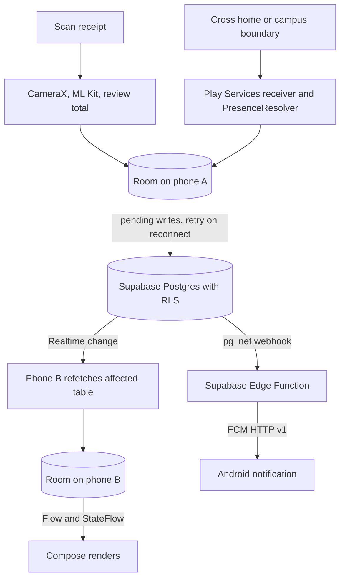

# From trigger to roommate

The receipt image stays on A. B can render a bill even if notifications are disabled. For the diagram-to-file mapping, see [[ARCHITECTURE]]. For the rationale and the security boundary, see [[02 - Supabase]].
