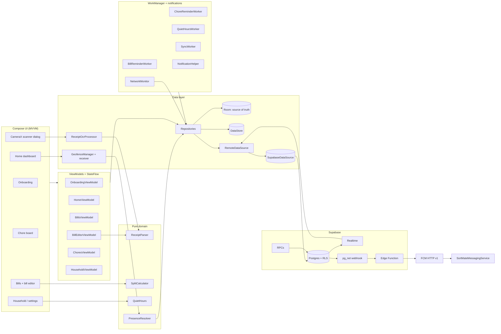
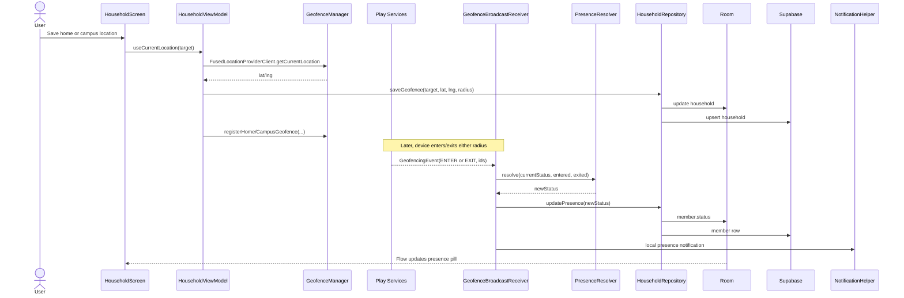
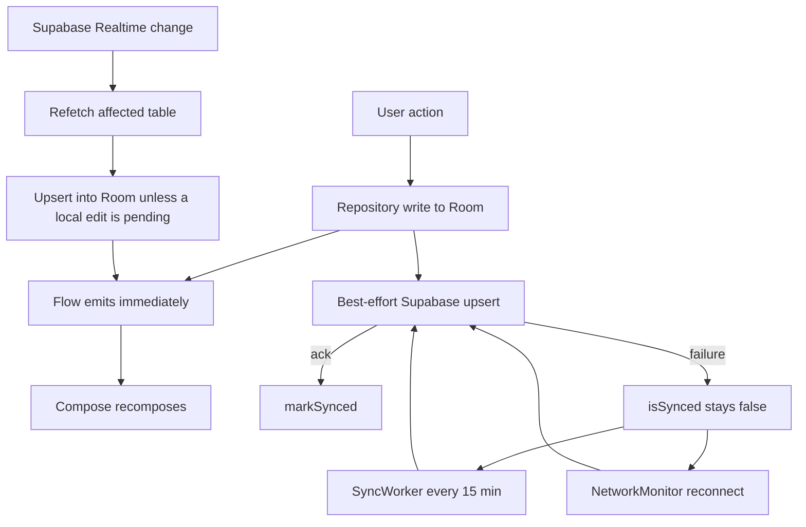
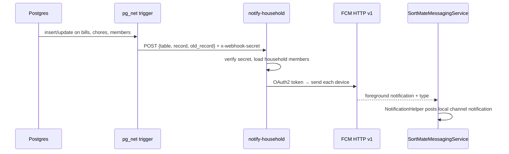

# SortMate — Architecture

This document maps the CS312 proposal flowchart onto the concrete Android implementation and records the trade-offs made for a defensible, demo-friendly student project.

Related notes: [[02 - Supabase]] · [[03 - Presence]] · [[04 - Evaluation]] · [[05 - Defense]] · [[06 - Tickets]]

---

## 1. Goals and constraints

- Native Kotlin Android app, Android 8.0+ (`minSdk 26`), `compileSdk`/`targetSdk` 37.
- On-device receipt OCR with **CameraX + ML Kit**.
- Home **and campus** geofenced presence with **Google Play Services Location**.
- Offline-first storage with **Room**; **Supabase Postgres** for multi-device sync; **FCM** for pushes.
- MVVM with `StateFlow` and Compose.
- No bank, payment gateway, or money movement. SortMate only calculates shares and records who paid.
- Cloud credentials are optional at build time so the app can be graded/demoed without a project.
- No paid Firebase plan: Supabase replaces Firestore, Auth, and Cloud Functions; FCM remains free on Spark.

---

## 2. High-level components



`AppContainer` is a manual dependency container (no Hilt) that owns the database, DataStore, Supabase client, repositories, location helpers, OCR processor, notification helper, network monitor, and app-wide `CoroutineScope`. `SortMateApplication.onCreate()` builds it and starts three long-lived collectors:

1. Watch `session.householdId` → reschedule quiet hours whenever the household window changes.
2. Combine `session.householdId` with `NetworkMonitor.isOnline` → start/stop Realtime and flush the outbox on reconnect.
3. Watch `session.memberId` → upload the FCM token once Messaging returns one.

---

## 3. Flowchart mapping

| Proposal step | Implementation | Key files |
| --- | --- | --- |
| **User action / sensor event** | Compose button ("Scan bill") or geofence broadcast | `ui/SortMateApp.kt`, `location/GeofenceBroadcastReceiver.kt` |
| **Trigger type?** | Two entry paths: scanner dialog vs. geofence receiver | `ui/bills/ReceiptScannerDialog.kt`, `location/GeofenceManager.kt` |
| **Scan bill / receipt** | CameraX `ImageCapture` → cache file → ML Kit `TextRecognition` | `ui/bills/ReceiptScannerDialog.kt`, `ocr/ReceiptOcrProcessor.kt` |
| **Cross location boundary** | Home + campus `Geofence`s → `GeofencingEvent` → `PresenceResolver` | `location/GeofenceManager.kt`, `domain/PresenceResolver.kt` |
| **Validate + store in Room** | Repositories validate inputs, write entities transactionally; DAOs expose `Flow` | `data/repository/*`, `data/local/*` |
| **Sync Supabase** | Repositories upsert through `RemoteDataSource`; Realtime refetches changes; `SyncWorker` retries unsynced rows | `data/remote/SupabaseDataSource.kt`, `data/sync/RealtimeSyncManager.kt`, `notifications/worker/SyncWorker.kt` |
| **FCM push alert** | Postgres webhook → Edge Function → FCM; local scheduling by WorkManager | `supabase/functions/notify-household/index.ts`, `notifications/SortMateMessagingService.kt` |
| **Update roommates' UI** | Room `Flow` emissions drive `StateFlow` → recomposition | all ViewModels |
| **Process complete** | UI confirmation (bill saved, presence pill changed, chore checked) | screens |

---

## 4. Receipt pipeline


Design notes:

- ML Kit text recognition runs **on-device**; no receipt image leaves the phone.
- `ReceiptParser` is pure Kotlin: strong keywords (`grand total`, `total due`, `amount due`) beat weak (`total`), while `subtotal`, `VAT`, `tax`, `discount`, `cash`, and `change` are ignored. With no keyword it falls back to the largest currency-shaped amount.
- Confidence is heuristic (94/82/58/0) and stored on the bill so the UI can display provenance.
- The captured image is copied into app-private `filesDir/receipts`. Only the local path is stored; uploading to Supabase Storage is future work.

---

## 5. Presence pipeline



- Both fences use `NEVER_EXPIRE`, 30-second responsiveness, and `ENTER | EXIT` transitions. One `PendingIntent` serves both.
- Registration requires fine location **and** background location. On Android 10+ the latter is granted from app settings ("Allow all the time"); the Household screen explains this and links to system settings.
- The receiver only knows which fence fired. `PresenceResolver` applies deterministic rules for overlapping events; see [[03 - Presence]] and ADR-0002.
- The Household tab exposes **Home**, **Campus**, and **Away** buttons that call the same `updatePresence` path as the receiver.

---

## 6. Data model

### Room (UI source of truth)

| Table | Important columns | Notes |
| --- | --- | --- |
| `households` | `id`, `name`, `joinCode`, `quietStartMinutes`, `quietEndMinutes`, `geofenceRadiusMeters`, `homeLatitude`, `homeLongitude`, `campusLatitude`, `campusLongitude`, `campusRadiusMeters`, `isSynced` | One active household per install |
| `members` | `id`, `householdId`, `name`, `role`, `status`, `fcmToken`, `isSynced` | `status` is `HOME`, `CAMPUS`, `AWAY` |
| `bills` | `id`, `householdId`, `title`, `merchant`, `totalCents`, `paidByMemberId`, `splitAmongMemberIds`, `splitType`, `dueAt`, `receiptUri`, `ocrConfidence`, `isSettled`, `isDeleted` | Money is stored in integer cents |
| `chores` | `id`, `householdId`, `title`, `assignedMemberId`, `dueAt`, `isCompleted`, `completedAt`, `isDeleted` | Soft delete keeps remote sync deterministic |

- Timestamps are epoch milliseconds (`Long`) to avoid `Date`/timezone serialization.
- `splitAmongMemberIds` is a `List<String>` stored comma-separated by `Converters`; IDs are UUIDs, so commas never occur.
- `isSynced` and `isDeleted` implement a lightweight outbox: repositories write locally first, then mark the row synced only after Supabase acknowledges. `SyncWorker` replays unsynced rows every 15 minutes.
- Room schema v2 adds the three campus columns. `app/schemas/.../2.json` is committed; v1 → v2 is an additive `ALTER TABLE` migration.

### DataStore

`sortmate_session` keeps `memberId`, `householdId`, `displayName`, `onboardingComplete`, and four notification toggles. The root composable switches between onboarding and main navigation purely from this flow, so "reset local data" returns to onboarding without manual navigation.

### Supabase Postgres

```
households
  id uuid pk, name, join_code unique, quiet_start_minutes, quiet_end_minutes,
  geofence_radius_meters, home_latitude, home_longitude,
  campus_latitude, campus_longitude, campus_radius_meters, timestamps

members
  id uuid pk (= auth.uid()), household_id fk, auth_user_id unique fk,
  name, role, status, fcm_token, timestamps

bills
  id uuid pk, household_id fk, title, merchant, total_cents,
  paid_by_member_id fk, split_among_member_ids uuid[], split_type,
  due_at, receipt_uri, ocr_confidence, is_settled, is_deleted,
  created_by, updated_by, timestamps

chores
  id uuid pk, household_id fk, title, assigned_member_id fk,
  due_at, is_completed, completed_at, is_deleted,
  created_by, updated_by, timestamps

app_config  -- private, no RLS policies; service_role only
  key text pk, value text
```

Join flow: `join_household(p_join_code, p_display_name)` resolves the code inside a `security definer` function, upserts the caller's member row, and returns `{household, member}`. The client then fetches members, bills, and chores and writes them into Room in one transaction.

### Row Level Security

- `is_household_member(hid)` is a `security definer` helper comparing `members.auth_user_id` to `auth.uid()`.
- `households`: select/update for members.
- `members`: household members can read; a caller can update their own name, presence and FCM token. Only create/join RPCs assign membership.
- `bills`/`chores`: members may select, insert and update, including soft delete.
- `app_config`: no anon/authenticated access. The Edge Function reads it with `service_role`.
- Client grants are explicit: changing identity or membership is outside normal row updates.

---

## 7. Synchronization strategy

**Room is the single source of truth for the UI.** Supabase is transport, not a second UI cache.



- **Live:** `RealtimeSyncManager` opens one channel per table filtered by household, then refetches the affected table and merges rows. Refetching keeps merge logic in one place and avoids decoding partial `old_record` payloads. `members` uses `replica identity full`.
- **Catch-up:** `SyncWorker` runs every 15 minutes when a network is available: it pushes unsynced rows, then refreshes the local snapshot.
- **Reconnect:** `NetworkMonitor` emits connectivity changes. On reconnect the app stops/starts Realtime, runs `syncPending()` for households, bills, and chores, then `refreshFromRemote()`.
- **Outbox protection:** both Realtime and catch-up use a transactional pending-row check. The ACK marks only the uploaded local version. Device clocks are not compared with Postgres to decide whether to discard a pending edit.
- **Conflicts:** two members updating the same cloud row resolve in server write order; there is no per-field merge.
- **Deletes:** bills and chores are soft-deleted locally and remotely (`is_deleted = true`), so every device converges on the tombstone. UI queries filter `isDeleted = 0`.

---

## 8. Push notifications



- The trigger reads `webhook_url` and `webhook_secret` from private `app_config`, so no secret is hardcoded in SQL.
- The Edge Function skips the actor and, for presence updates, the member whose status changed.
- In the background Android displays the FCM notification payload directly. Tokens reported as `UNREGISTERED` are cleared.
- The function accepts either the new `SUPABASE_SECRET_KEYS` map or the legacy `SUPABASE_SERVICE_ROLE_KEY`; opaque `sb_secret_` keys travel only in the `apikey` header.

---

## 9. Background work and alerts

| Worker / service | Schedule | Responsibility |
| --- | --- | --- |
| `BillReminderWorker` | Daily, initial delay to 08:00 | Sums unpaid bills due in the next 24 h and posts one notification |
| `ChoreReminderWorker` | Daily, initial delay to 18:00 | Counts open chores due today/tomorrow |
| `QuietHoursWorker` | Daily, initial delay to household start | "Study mode is on" reminder |
| `SyncWorker` | Every 15 min, network constraint | Push unsynced rows + refresh snapshot |
| `BootReceiver` | `BOOT_COMPLETED` | Reschedules work and re-registers both geofences if coordinates exist |
| `SortMateMessagingService` | FCM delivery | Uploads the token and displays remote alerts using data fields (`title`, `body`, `type`) |

Channels: `bill_reminders`, `chore_reminders`, `household_alerts`, `quiet_hours`. Notification permission is requested on first entry to the main app (Android 13+). Every sender checks both the runtime permission and `areNotificationsEnabled()`.

`ReminderScheduler` also exposes cancel paths; the Household toggles cancel the corresponding unique periodic work.

---

## 10. Permissions

| Permission | When | Behaviour if denied |
| --- | --- | --- |
| `CAMERA` | Scanner dialog | Dialog shows a rationale and an "Allow camera" button |
| `ACCESS_FINE_LOCATION` | "Save current location" | House screen explains and requests it |
| `ACCESS_BACKGROUND_LOCATION` | Geofence registration | Registration reports a readable error and links to system settings |
| `POST_NOTIFICATIONS` | First main screen | Reminders are skipped silently; in-app UI still works |
| `RECEIVE_BOOT_COMPLETED` | Manifest only | Background features are not restored after reboot |

---

## 11. Design decisions and trade-offs

| Decision | Why | Cost |
| --- | --- | --- |
| Compose + Material 3 | Faster iteration, modern course-relevant stack, easy theming | Slightly steeper than XML for beginners |
| Manual `AppContainer` instead of Hilt | Avoids annotation-processor complexity in a small app; transparent for the defense | Manual wiring as the app grows |
| Room as UI truth, not a remote cache | Works fully offline and in demo mode; predictable state | Need explicit sync reconciliation |
| Supabase instead of Firestore | Free Postgres, Auth, Realtime, and Edge Functions; no Blaze | Deviates from the proposal's vendor table; documented in ADR-0001 |
| FCM retained | Free on Spark and already integrated | Service-account secret must be managed |
| Anonymous Supabase auth | No account screens; each install gets a stable `auth.uid()` | No cross-device identity recovery |
| Two geofences + pure resolver | Matches the proposal's campus requirement; testable without a device | Missed ENTER events can leave stale status until the next transition |
| On-device OCR with heuristic parser | Privacy, no API keys, offline capability | Merchant/total heuristics are imperfect on unusual receipts |
| Equal split only | Matches the proposal's core use case and keeps totals exact | No weighted/custom split UI yet |
| Demo simulate buttons | Defense can show the presence flow indoors | Does not replace a real field test |

---

## 12. Extension points

- `SplitType` already exists on `BillEntity`; add `WEIGHTED`/`CUSTOM` and a calculator strategy.
- Upload receipt images to Supabase Storage and store a download URL instead of a local path.
- Replace last-write-wins with `updatedAt` conflict prompts or per-field merge.
- Add real accounts (email link or OAuth) and migrate anonymous members by linking identities.
- Add recurring bills and chore rotation.
- Add instrumentation tests for Room + repositories and Compose UI tests for onboarding and bill creation.
