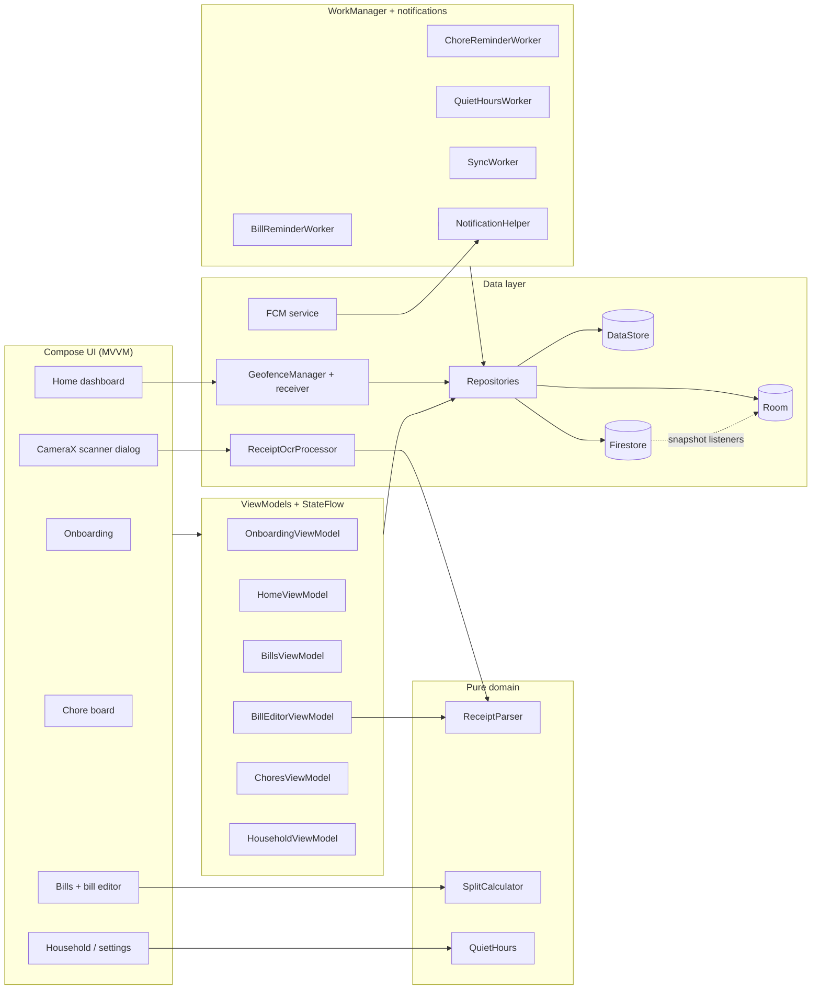
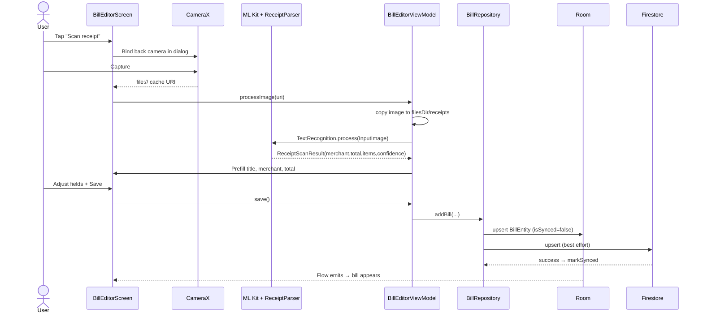
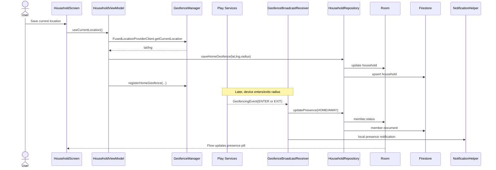
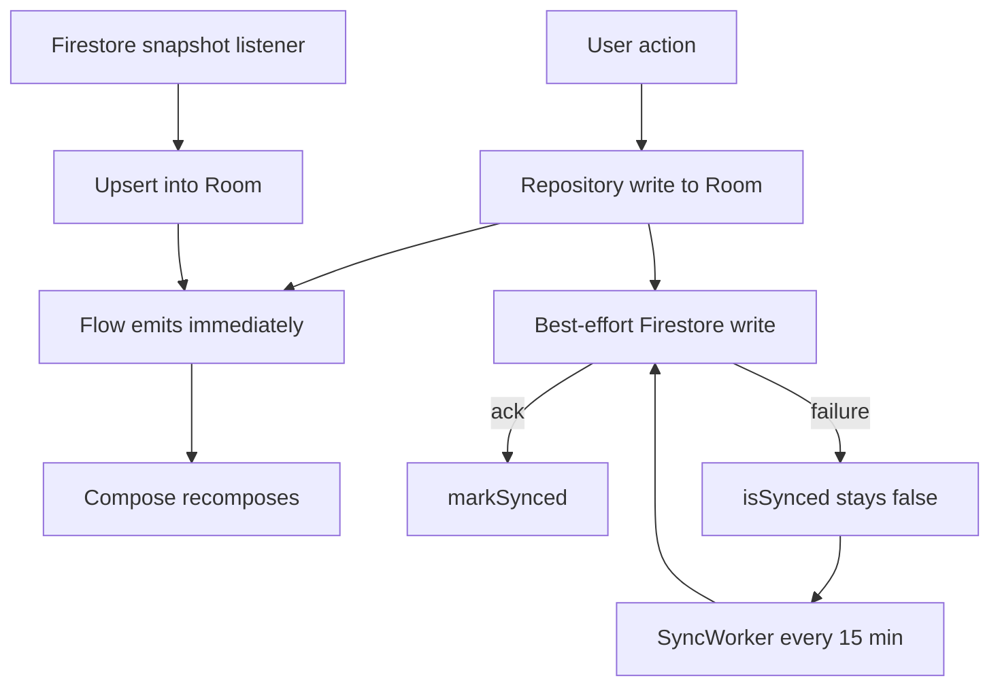

# SortMate — Architecture

This document maps the CS312 proposal flowchart onto the concrete Android implementation and records the trade-offs made for a defensible, demo-friendly student project.

---

## 1. Goals and constraints

- Native Kotlin Android app, Android 8.0+ (`minSdk 26`), `compileSdk`/`targetSdk` 37.
- On-device receipt OCR with **CameraX + ML Kit**.
- Geofenced presence with **Google Play Services Location**.
- Offline-first storage with **Room**; **Firestore** for realtime multi-device sync; **FCM** for pushes.
- MVVM with `StateFlow` and Compose.
- No bank, payment gateway, or money movement. SortMate only calculates shares and records who paid.
- Firebase is optional at build time so the app can be graded/demoed without project credentials.

---

## 2. High-level components



`AppContainer` is a manual dependency container (no Hilt) that owns the database, DataStore, Firestore adapter, repositories, location helpers, OCR processor, notification helper, and app-wide `CoroutineScope`. `SortMateApplication.onCreate()` builds it and starts two long-lived collectors:

1. Watch `session.householdId` → start/stop Firestore snapshot listeners and reschedule quiet hours whenever the household window changes.
2. Watch `session.memberId` → fetch the FCM token and persist it on the member document.

---

## 3. Flowchart mapping

| Proposal step | Implementation | Key files |
| --- | --- | --- |
| **User action / sensor event** | Compose button ("Scan bill") or geofence broadcast | `ui/SortMateApp.kt`, `location/GeofenceBroadcastReceiver.kt` |
| **Trigger type?** | Two separate entry paths: scanner dialog vs. geofence receiver | `ui/bills/ReceiptScannerDialog.kt`, `location/GeofenceManager.kt` |
| **Scan bill / receipt** | CameraX `ImageCapture` → cache file → ML Kit `TextRecognition` | `ui/bills/ReceiptScannerDialog.kt`, `ocr/ReceiptOcrProcessor.kt` |
| **Cross location boundary** | `GeofencingClient` with enter/exit transitions → `GeofencingEvent` | `location/GeofenceManager.kt`, `location/GeofenceBroadcastReceiver.kt` |
| **Validate + store in Room** | Repositories validate inputs, write entities transactionally; DAOs expose `Flow` | `data/repository/*`, `data/local/*` |
| **Sync Firestore** | Repositories push writes; snapshot listeners pull changes; `SyncWorker` retries unsynced rows | `data/remote/FirestoreDataSource.kt`, `data/sync/RealtimeSyncManager.kt`, `notifications/worker/SyncWorker.kt` |
| **FCM push alert** | Remote messages handled by `FirebaseMessagingService`; local scheduling by WorkManager | `notifications/SortMateMessagingService.kt`, `notifications/ReminderScheduler.kt` |
| **Update roommates' UI** | Room `Flow` emissions drive `StateFlow` → recomposition | all ViewModels |
| **Process complete** | UI confirmation (bill saved, presence pill changed, chore checked) | screens |

---

## 4. Receipt pipeline



Design notes:

- ML Kit text recognition runs **on-device**; no receipt image leaves the phone.
- `ReceiptParser` is pure Kotlin: strong keywords (`grand total`, `total due`, `amount due`) beat weak (`total`), while `subtotal`, `VAT`, `tax`, `discount`, `cash`, and `change` are ignored. With no keyword it falls back to the largest currency-shaped amount.
- Confidence is heuristic (94/82/58/0) and stored on the bill so the UI can display provenance.
- The captured image is copied into app-private `filesDir/receipts`. Only the local path is stored; uploading to Firebase Storage is future work.

---

## 5. Geofence pipeline



- The home geofence is a single `Geofence` with `NEVER_EXPIRE`, 30-second responsiveness, and both `ENTER` and `EXIT` transitions.
- Registration requires fine location **and** background location. On Android 10+ the latter is granted from app settings ("Allow all the time"); the Household screen explains this and links to system settings.
- Because demos rarely involve walking outside, the Household tab exposes **Arrive home** / **Leave home** buttons that call the same `updatePresence` path and emit the same notification.

---

## 6. Data model

### Room (UI source of truth)

| Table | Important columns | Notes |
| --- | --- | --- |
| `households` | `id`, `name`, `joinCode`, `quietStartMinutes`, `quietEndMinutes`, `geofenceRadiusMeters`, `homeLatitude`, `homeLongitude`, `isSynced` | One active household per install |
| `members` | `id`, `householdId`, `name`, `role`, `status`, `fcmToken`, `isSynced` | `status` is `HOME`, `CAMPUS`, `AWAY` |
| `bills` | `id`, `householdId`, `title`, `merchant`, `totalCents`, `paidByMemberId`, `splitAmongMemberIds`, `splitType`, `dueAt`, `receiptUri`, `ocrConfidence`, `isSettled`, `isDeleted` | Money is stored in integer cents |
| `chores` | `id`, `householdId`, `title`, `assignedMemberId`, `dueAt`, `isCompleted`, `completedAt`, `isDeleted` | Soft delete keeps remote sync deterministic |

- Timestamps are epoch milliseconds (`Long`) to avoid `Date`/timezone serialization.
- `splitAmongMemberIds` is a `List<String>` stored comma-separated by `Converters`; IDs are UUIDs and anonymous Firebase UIDs, so commas never occur.
- `isSynced` and `isDeleted` implement a lightweight outbox: repositories write locally first, then mark the row synced only after Firestore acknowledges. `SyncWorker` replays unsynced rows every 15 minutes.

### DataStore

`sortmate_session` keeps `memberId`, `householdId`, `displayName`, `onboardingComplete`, and four notification toggles. The root composable switches between onboarding and main navigation purely from this flow, so "reset local data" returns to onboarding without manual navigation.

### Firestore

```
households/{householdId}
  name, joinCode, quietStartMinutes, quietEndMinutes,
  geofenceRadiusMeters, homeLatitude, homeLongitude, updatedAt

households/{householdId}/members/{memberId}
  name, role, status, fcmToken, updatedAt

households/{householdId}/bills/{billId}
  title, merchant, totalCents, paidByMemberId,
  splitAmongMemberIds[], splitType, dueAt, createdAt,
  receiptUri, ocrConfidence, isSettled, updatedAt

households/{householdId}/chores/{choreId}
  title, assignedMemberId, dueAt, isCompleted, completedAt,
  createdAt, updatedAt
```

Join flow: `HouseholdRepository.joinHousehold` queries `households.whereEqualTo("joinCode", code).limit(1)`, copies the household, members, bills, and chores into Room, then creates the member document.

---

## 7. Synchronization strategy

**Room is the single source of truth for the UI.** Firestore is transport, not a second UI cache.



- **Live:** `RealtimeSyncManager` registers snapshot listeners for the household, members, bills, and chores while the app process is alive. Changes are upserted into Room, so every ViewModel updates automatically.
- **Catch-up:** `SyncWorker` runs every 15 minutes when a network is available: it pushes unsynced rows (deleting from Firestore when `isDeleted`), then refreshes the local snapshot.
- **Conflicts:** last-write-wins by `updatedAt`. This is intentionally simple for a 3–6 person household; the repository boundary is the seam where CRDT/version vectors could be added.
- **Deletes:** bills and chores are soft-deleted locally and hard-deleted remotely, avoiding tombstones in Firestore.

---

## 8. Background work and alerts

| Worker / service | Schedule | Responsibility |
| --- | --- | --- |
| `BillReminderWorker` | Daily, initial delay to 08:00 | Sums unpaid bills due in the next 24 h and posts one notification |
| `ChoreReminderWorker` | Daily, initial delay to 18:00 | Counts open chores due today/tomorrow |
| `QuietHoursWorker` | Daily, initial delay to household start | "Study mode is on" reminder |
| `SyncWorker` | Every 15 min, network constraint | Push unsynced rows + refresh snapshot |
| `BootReceiver` | `BOOT_COMPLETED` | Reschedules work and re-registers the geofence if coordinates exist |
| `SortMateMessagingService` | FCM delivery | Displays remote alerts using FCM data fields (`title`, `body`, `type`) |

Channels: `bill_reminders`, `chore_reminders`, `household_alerts`, `quiet_hours`. Notification permission is requested on first entry to the main app (Android 13+). Every sender checks both the runtime permission and `areNotificationsEnabled()`.

`ReminderScheduler` also exposes cancel paths; the Household toggles cancel the corresponding unique periodic work.

---

## 9. Permissions

| Permission | When | Behaviour if denied |
| --- | --- | --- |
| `CAMERA` | Scanner dialog | Dialog shows a rationale and an "Allow camera" button |
| `ACCESS_FINE_LOCATION` | "Save current location" | House screen explains and requests it |
| `ACCESS_BACKGROUND_LOCATION` | Geofence registration | Registration reports a readable error and links to system settings |
| `POST_NOTIFICATIONS` | First main screen | Reminders are skipped silently; in-app UI still works |
| `RECEIVE_BOOT_COMPLETED` | Manifest only | Background features are not restored after reboot |

---

## 10. Design decisions and trade-offs

| Decision | Why | Cost |
| --- | --- | --- |
| Compose + Material 3 | Faster iteration, modern course-relevant stack, easy theming | Slightly steeper than XML for beginners |
| Manual `AppContainer` instead of Hilt | Avoids annotation-processor complexity in a small app; transparent for the defense | Manual wiring as the app grows |
| Room as UI truth, not Firestore cache | Works fully offline and in demo mode; predictable state | Need explicit sync reconciliation |
| Conditional `google-services` plugin | The project builds and runs without credentials | Firebase code paths are only exercised after setup |
| Anonymous Firebase Auth | No account screens; each install gets a UID | No cross-device identity recovery |
| On-device OCR with heuristic parser | Privacy, no API keys, offline capability | Merchant/total heuristics are imperfect on unusual receipts |
| Equal split only | Matches the proposal's core use case and keeps totals exact | No weighted/custom split UI yet |
| Demo simulate buttons | Defense can show the geofence flow indoors | Does not replace a real field test |

---

## 11. Extension points

- `SplitType` already exists on `BillEntity`; add `WEIGHTED`/`CUSTOM` and a calculator strategy.
- Upload receipt images to Firebase Storage and store a download URL instead of a local path.
- Replace last-write-wins with `updatedAt` conflict prompts or per-field merge.
- Add household membership claims / custom auth for production-grade security rules.
- Add recurring bills and chore rotation.
- Add instrumentation tests for Room + repositories and Compose UI tests for onboarding and bill creation.
